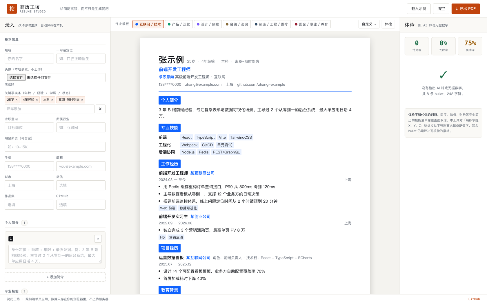
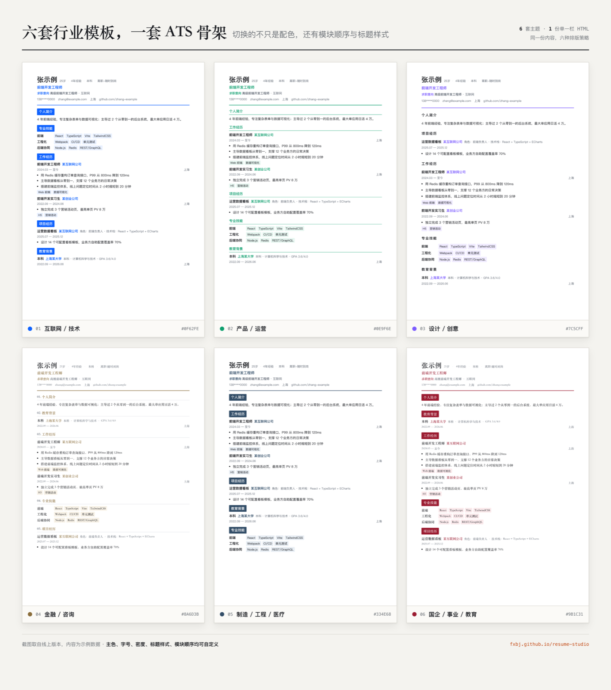

# resume-studio · 简历工坊

> 给 AI 编程助手用的简历 Skill。核心主张只有一句：**简历是事实的排版，不是文字的创作。**

[](LICENSE)
[](https://www.python.org/)
[]()
[](https://github.com/FXBJ/resume-studio/actions/workflows/ci.yml)

用自然语言描述你的经历，它产出**可直接投递的一页 PDF**。内置六套按行业大类划分的模板、
事实保真闸门、反 AI 味体检，全部零第三方依赖。



**在线体验 → https://fxbj.github.io/resume-studio/**（示例数据直链：`?sample=1`，无需登录、无需安装、不上传任何数据）

## 两种用法

| 形态 | 适合 | 入口 |
|---|---|---|
| **网页应用** `app/` | 不想装任何东西，打开就能用 | [在线体验](https://fxbj.github.io/resume-studio/) · 或本地打开 `app/index.html` |
| **AI Skill** `scripts/` `references/` | 已经在用 Claude / Codex 等助手 | 把仓库链接发给助手：「帮我装这个 Skill，然后用它写简历」 |

网页应用与 Skill **同源同规则**：同一套六主题定义、同一套体检词表、同一条 ATS 约束。
改一边必须同步另一边（CI 会各自校验）。

### 网页应用 · 30 秒上手

```bash
cd app
python3 -m http.server 8000        # 或直接用浏览器打开 index.html
# 访问 http://localhost:8000/?sample=1 可直接看示例效果
```

三栏布局：**左边录入 → 中间实时预览 → 右边体检报告**。

- 六套行业模板一键切换，切换即重排模块顺序与配色
- 自定义面板：主色、字号、密度、栏目标题样式、头像尺寸、模块开关与顺序
- 头像本地读取，**不上传服务器**
- 内容改动自动存 localStorage，刷新不丢
- 「导出 PDF」走浏览器打印，A4 一页
- 手机可用：三栏自动折成单列，预览按 A4 原宽整体缩放，不压扁、不截断

**`?sample=1` 会载入示例数据**，适合做演示链接。

---

## 为什么还要做一个

调研了 7 个同类开源 Skill 与 Reactive Resume 等产品后，发现三个反复出现、但很少被真正解决的问题：

| 问题 | 现状 | 本项目的做法 |
|---|---|---|
| **编造数字** | 7 个项目里 5 个把 "never invent" 写进 README——因为这是最高频事故 | `check_facts.py` 把嘱咐变成**可执行闸门**：输出里每个数字必须能在 fact_sheet 找到来源，找不到就标红并禁止交付；缺数写 `【待补】`，绝不填一个看起来合理的值 |
| **AI 味** | HR 三秒就能闻出套话 | `lint.py` 检查套话词表、破折号、bullet 长度变异系数、`-ing` 结尾、空洞形容词、强动词覆盖率、证据密度 |
| **模板不会选** | 市面按「实用系 / 个性系」分模板，用户照样不知道投互联网该用哪套 | 六套模板**按行业大类**分，问一句「你投什么行业」直接定 |

另外两个工程层面的通病：**改版要写代码**（Reactive Resume 要写 CSS）和**中断不可续**。

## 核心特性

**双模式**
- `guided` 引导模式：多轮访谈帮需求不明确的用户厘清定位。先定位、后收集；先盘点、后深挖。一次只问一个问题，每轮落盘可续。
- `optimize` 优化模式：接收已有简历（md / txt / html / docx），自动完成润色、结构化重组与专业排版，给 before / after 让用户确认。

**六套行业模板**（一套骨架 + 六个主题 dict，不是六份重复代码）

| key | 行业 | 模块顺序特点 |
|---|---|---|
| `tech` | 互联网 / 软件 / 技术 | 技能前置，蓝色 |
| `product` | 产品 / 运营 / 市场 | 成果量化前置，绿色 |
| `design` | 设计 / 创意 / 内容 | 作品集优先，可放头像，紫色 |
| `finance` | 金融 / 咨询 / 法律 | 学历与证书前置，衬线，编号栏题 |
| `engineering` | 制造 / 工程 / 医疗 / 基建 | 项目与技术规范前置，石墨蓝 |
| `public` | 国企 / 事业 / 教育 / 公共部门 | 荣誉证书前置，绛红，庄重 |



模板预览：打开 [`examples/demo/`](examples/demo/) 下任意 HTML 即可，无需安装任何东西。

**参数化自定义**——不用写 CSS

`theme_overrides` 白名单 12 个字段：`accent` / `accent_soft` / `ink` / `muted` / `rule` /
`font_scale` / `density` / `show_photo` / `photo_w` / `photo_h` / `photo_radius` /
`module_order` / `section_style` / `labels`。自然语言到参数有明确映射表，见
[`references/theme-schema.md`](references/theme-schema.md)。

**三道质检闸门**（交付前必跑）

```bash
python3 scripts/lint.py --data resume.json           # 反 AI 味 + ATS 风险 + 一页估算
python3 scripts/check_facts.py --data resume.json --raw raw.json   # 无源数字标红
python3 scripts/score.py --data resume.json --jd jd.txt            # JD 匹配度 + 差距清单
```

**零第三方依赖**——这不是口号，是设计约束

| 能力 | 常规做法 | 这里 |
|---|---|---|
| 数据格式 | PyYAML | **JSON**（标准库直接支持） |
| 模板引擎 | Jinja2 | **Python 字符串 + 极简行内标记** |
| docx 解析 | python-docx | **`zipfile` + 正则抽 `word/document.xml`** |
| PDF 导出 | fpdf2 / wkhtmltopdf | **浏览器打印 → 存为 PDF** |
| 中文分词 | jieba | **精选词库 + 边界字 + 子串去重** |

装完即用，不会出现「依赖装不上所以用不了」。

## 快速开始

```bash
git clone https://github.com/FXBJ/resume-studio.git
cd resume-studio

# 看六套模板
python3 scripts/themes.py list

# 用示例数据渲染一页简历
python3 scripts/render.py --data examples/resume.example.json --out resume.html

# 换行业模板
python3 scripts/render.py --data examples/resume.example.json --out resume.html --theme finance
```

浏览器打开 `resume.html` → 打印 → 存为 PDF（A4，勾选「背景图形」）即得可投递成品。

### 作为 Skill 安装

把整个目录放到技能的发现目录即可：

```bash
# Claude Code
cp -R resume-studio ~/.claude/skills/

# Codex / 其他共用目录
cp -R resume-studio ~/.agents/skills/
```

然后在对话里说「帮我写简历」「优化这份简历」「按这个 JD 改一版」即可触发。

## 项目结构

```
resume-studio/
├── app/                          # 网页应用（纯前端，零依赖）
│   ├── index.html                # 三栏骨架
│   ├── styles.css                # 应用外观（校勘仪方向）
│   └── app.js                    # 状态 / 渲染 / 体检 / 交互
├── tests/
│   └── app.test.js               # 网页应用核心逻辑测试（33 项）
├── SKILL.md                     # 入口：模式路由 + 三条硬约束 + 命令速查
├── scripts/                     # Skill 侧脚本，全部零第三方依赖
│   ├── themes.py                # 六套行业主题 + resolve_theme 白名单校验
│   ├── render.py                # resume.json + theme → 单页自包含 HTML
│   ├── lint.py                  # 反 AI 味 + ATS 风险 + 一页体积估算
│   ├── check_facts.py           # 无源数字/名称标红（事实保真闸门）
│   ├── parse_resume.py          # 已有简历 → 结构化分段（md/txt/html/docx）
│   └── score.py                 # JD 匹配度评分 + 差距清单
├── references/                  # 按需加载的协议文档
│   ├── guided-interview.md      # 引导模式 6 步访谈（STAR-L）
│   ├── optimize-protocol.md     # 优化模式五步协议
│   ├── bullet-craft.md          # bullet 公式 + 强动词分级 + 不重复原则
│   ├── industry-guide.md        # 六套行业模板指南 + 一岗一版
│   ├── theme-schema.md          # 参数 schema + 自然语言映射 + 色值速查
│   └── fact-protocol.md         # 事实保真协议
├── examples/
│   ├── raw.example.json         # 事实清单示例
│   ├── resume.example.json      # 投递快照示例
│   └── demo/                    # 六套模板静态预览
└── docs/
    ├── design.md                # 完整设计方案与调研结论
    └── app-screenshot.png       # 网页应用截图
```

## 测试

```bash
# 网页应用核心逻辑（六主题 / ATS 结构 / 自定义覆盖 / 体检引擎 / 模块开关）
node tests/app.test.js

# Skill 侧脚本
python3 scripts/render.py --data examples/resume.example.json --out /tmp/r.html
python3 scripts/lint.py --data examples/resume.example.json --strict
python3 scripts/check_facts.py --data examples/resume.example.json --raw examples/raw.example.json --strict
```

CI 会同时跑两侧，并额外校验 Python 3.9 语法兼容与零第三方依赖。

## 三条不可逾越的硬约束

1. **不编造。** 输出中每个公司、学校、职位、日期、数字必须来自用户提供的内容。缺数字写 `【待补】`，不许填一个看起来合理的数。
2. **不替代人的判断。** 涉及职业选择、薪资、跳槽决策时给信息与选项，不给结论式指令。
3. **敏感信息一律脱敏。** 用户粘贴的内容含他人隐私时，先提醒并改成示例化表述。

## 路线图

- [x] 双模式（引导 / 优化）
- [x] 六套行业模板 + 参数化自定义
- [x] 三道质检闸门（事实 / AI 味 / JD 匹配）
- [x] 头像 base64 内嵌、经历标签、志愿与校园模块
- [ ] 中文分词升级（jieba 可选增强）
- [ ] 英文简历模板与措辞规范
- [ ] 学术 CV / 留学申请模板
- [ ] 投递记录与面试预测闭环

明确不做：算命占卜式职业判定、性格测试、薪资预测、代写虚假经历。

## 许可

[MIT](LICENSE)。可自由商用与二次分发——同类项目里有采用 CC BY-NC 4.0 的，商用需另行授权，这里不设这个限制。
